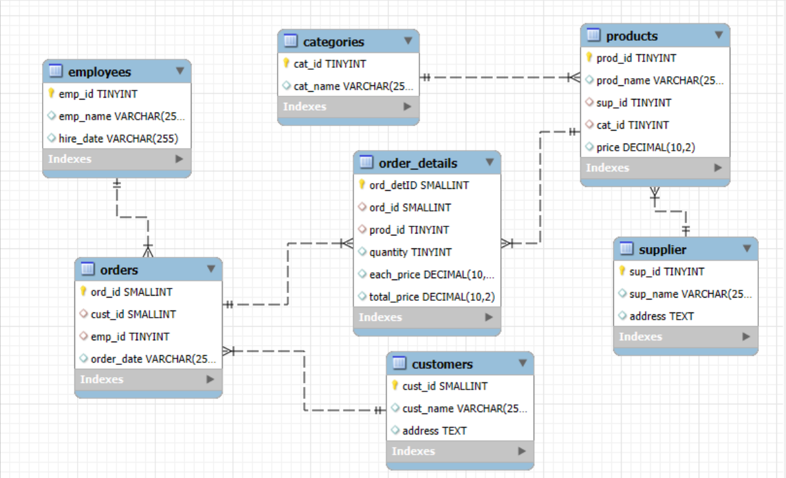

# Grocery Store Management — SQL Analysis Project

A relational database modeling a grocery store's suppliers, products, customers,
employees, and orders — built to design a normalized schema and answer real
business questions with SQL.

## Key Insights

- **Volume ≠ revenue**: Bath Soap sells the most units, but Hand Sanitizer earns
  the most revenue due to its higher price point.
- **Supplier concentration risk**: one supplier (Aarya) drives ~34% of total
  revenue across three categories.
- **Seasonal demand**: order volume and revenue peak in January and December,
  with April and October as clear troughs.
- **Customer value vs. frequency are different signals**: the most frequent
  buyer isn't the top spender, and vice versa.

Full write-up: [`key_findings.md`](./key_findings.md)

## Schema

7 interrelated tables — `supplier`, `categories`, `employees`, `customers`,
`products`, `orders`, `order_details` — connected by one-to-many foreign key
relationships.



## Tech Stack

- MySQL 8.0
- MySQL Workbench

## Project Structure

```
01-grocery-store-management/
├── README.md
├── grocery_store_management.sql   -- schema + data load + all analysis queries
├── key_findings.md                -- write-up of business insights
├── er_diagram.png
├── ER_Diagram.mwb                 -- MySQL Workbench model
├── dataset/                       -- the 7 source CSVs
└── docs/
    ├── Grocery_Store_SQL_Project.pptx
    └── Grocery_Store_Management_Report.docx
```

## Setup

1. Put the 7 CSV files in the `dataset/` folder.
2. Open `grocery_store_management.sql` in MySQL Workbench.
3. Replace `<PATH_TO_REPO>` in the `LOAD DATA LOCAL INFILE` statements with the
   folder where you cloned this repo.
4. Run the script section by section (schema → load → queries) — running the
   whole file at once will only show the last query's result grid in Workbench.

## Analysis Sections

1. Customer Insights
2. Product Performance
3. Sales & Order Trends
4. Supplier Contribution
5. Employee Performance
6. Order Details Deep Dive

See [`key_findings.md`](./key_findings.md) for the full results and interpretation.
